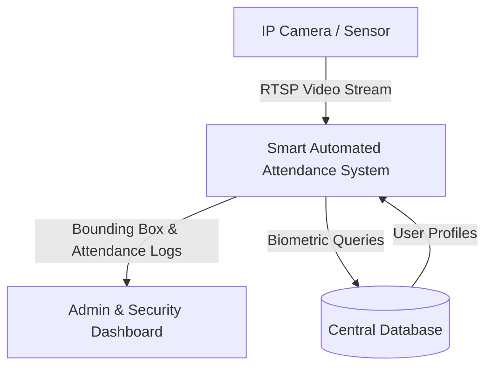
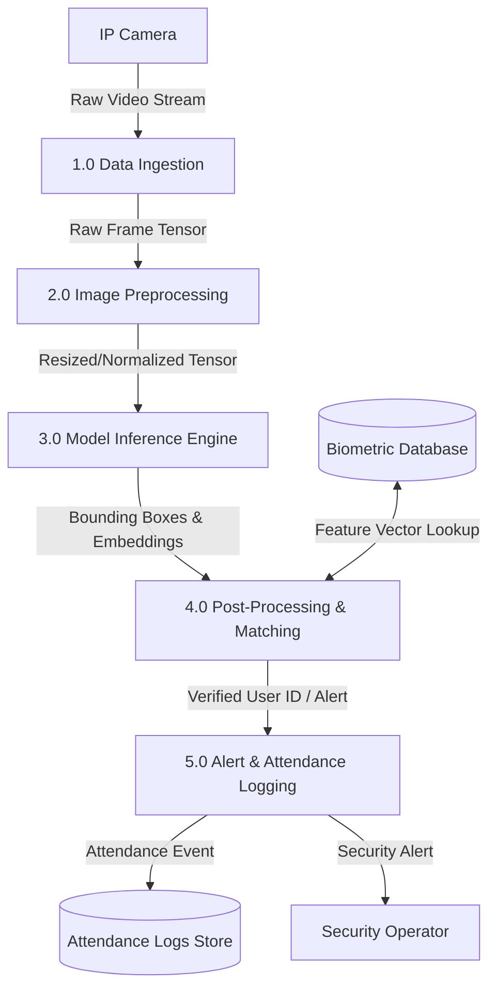

# AI Project Design and Development (AI-316)
## System Requirements & Software Architecture Specification
**Course:** AI Project Design and Development (AI-316)
**Lab Instructor:** Farhan Zafar Kayani

---

## Task 1: Functional & Non-Functional Requirements Breakdown

### 1.1 Functional Requirements (FR)
| ID | Category | Requirement Description | Priority |
| :--- | :--- | :--- | :--- |
| **FR-01** | Face Detection & Tracking | System must continuously detect and track human faces from video streams in real time. | High |
| **FR-02** | Attendance Logging | System must match recognized face embeddings against database records and log attendance timestamps. | High |
| **FR-03** | Database Synchronization | System must synchronize local event logs with central university cloud database servers every 5 minutes. | Medium |
| **FR-04** | Anomaly & Spoof Detection | System must detect anti-spoofing attempts (e.g., printed photo presentations) and flag security alerts. | High |
| **FR-05** | Administrative Dashboard | System must provide an interactive admin interface for manual override, log viewing, and reporting. | Medium |

### 1.2 Non-Functional Requirements (NFR)
| ID | Category | Metric / Specification Threshold | Priority |
| :--- | :--- | :--- | :--- |
| **NFR-01** | Inference Latency | Face detection and embedding recognition latency must remain < 200 ms per frame. | High |
| **NFR-02** | Model Accuracy | Model verification accuracy threshold must exceed 98.5% on benchmark validation sets. | High |
| **NFR-03** | Frame Rate | Ingestion and preprocessing pipeline must maintain a minimum frame throughput of 25 FPS. | High |
| **NFR-04** | Edge Device Power | Maximum power usage on edge deployment hardware (e.g., Jetson/NPU) must not exceed 25W. | Medium |
| **NFR-05** | Data Privacy & Security | All stored biometric facial embeddings must be encrypted at rest using AES-256 standards. | High |

---

## Task 2: System Boundary, User Personas, & Input/Output Mapping

### 2.1 Primary System Actors
* **Security Operator:** Monitors live alerts, system health, and physical camera feed status.
* **System Admin:** Manages user enrollment databases, model re-training pipelines, and system configuration rules.
* **Automated Trigger System:** Edge/Cloud system process that ingests RTSP video streams and triggers downstream notifications.

### 2.2 System Input/Output Specification
| Category | Item | Technical Parameters / Format |
| :--- | :--- | :--- |
| **System Inputs** | RTSP Video Streams | 1080p resolution @ 30 FPS, H.264/H.265 compression format |
| **System Inputs** | Sensor Parameters | Camera shutter speed, exposure levels, device ID, and spatial zone IDs |
| **System Outputs** | Bounding Boxes | Bounding coordinates [x_min, y_min, x_max, y_max], class IDs, and confidence scores |
| **System Outputs** | Alert Notifications | Real-time WebSocket/MQTT JSON payload alerts for unrecognized/spoofed entries |
| **System Outputs** | Attendance Logs | Structured CSV / SQL relational database entries (User_ID, Timestamp, Camera_ID) |

### 2.3 Operational Constraints
* **Maximum Memory Footprint:** Runtime RAM usage must remain below 4.0 GB on edge devices.
* **Bandwidth Limitations:** Maximum network uplink throughput capped at 5 Mbps per camera node.

---

## Task 3: Data-Flow Diagrams (DFD)

### 3.1 Level 0 (Context) Data-Flow Diagram

### 3.2 Level 1 Data-Flow Diagram

---

## Task 4: Modular Software Architecture Blueprint

The application is deconstructed into four core independent modules located in `src/`:
1. `DataIngestion` (`src/data_ingestion.py`): Stream connection and frame ingestion.
2. `ImagePreprocessor` (`src/image_preprocessor.py`): Tensor resizing, color transformation, and normalization.
3. `ModelInferenceEngine` (`src/model_inference.py`): Model weight initialization and forward pass execution.
4. `AlertLogger` (`src/alert_logger.py`): Logging, database synchronization, and alert dispatching.
